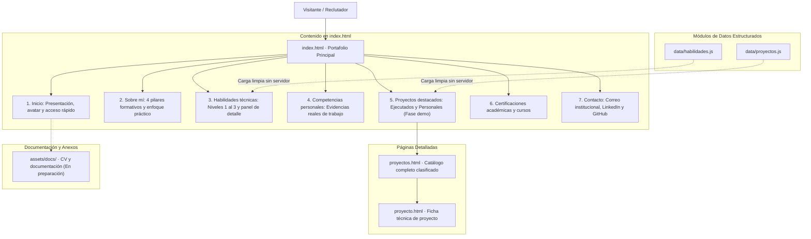
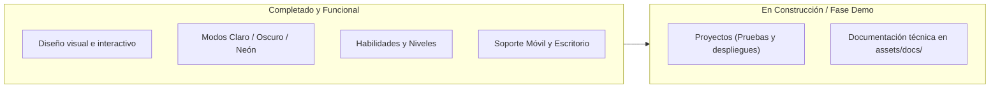

# Portafolio Personal · Pedro Pablo Huacanjulca Rodríguez

Sitio web y portafolio interactivo de Pedro Pablo Huacanjulca Rodríguez, estudiante de 6.º ciclo de Ingeniería de Sistemas en la Universidad Nacional de Ingeniería (UNI).

El objetivo central de este proyecto es presentar de manera clara, transparente y ágil el perfil académico, las habilidades técnicas y los proyectos aplicados ante reclutadores y equipos de tecnología interesados en incorporar talento para prácticas preprofesionales en desarrollo de software y análisis de datos.

---

## 1. Visión general del proyecto

A diferencia de sitios web convencionales que dependen de herramientas externas o paquetes pesados, este portafolio fue construido desde cero utilizando exclusivamente estándares nativos de la web (HTML5, CSS3 y JavaScript). Esto garantiza:

- **Carga instantánea:** Funciona de inmediato sin descargar bibliotecas pesadas de terceros.
- **Acceso universal:** Se puede visualizar abriendo directamente los archivos en cualquier computadora o navegando en línea a través de GitHub Pages.
- **Transparencia técnica:** Todo el diseño, las animaciones y la lógica provienen de código original y estructurado.
- **Adaptabilidad completa:** Optimizado para lectura cómoda tanto en teléfonos móviles como en monitores de escritorio.

---

## 2. Mapa de navegación y arquitectura

El siguiente diagrama explica cómo está organizado el contenido y cómo interactúan las distintas secciones del portafolio:



---

## 3. Estructura del directorio

La organización de carpetas y archivos mantiene una separación limpia entre presentación, lógica y datos:

```text
Pagina personal/
├── index.html              # Página principal con todas las secciones centrales
├── proyectos.html          # Vista de catálogo ampliado de proyectos
├── proyecto.html           # Ficha de detalle de proyecto en fase demostrativa
├── style.css               # Hoja de estilos con variables de color, tipografía y temas
├── script.js               # Lógica de interacción (temas, acordeón, cursor y animaciones)
├── README.md               # Resumen explicativo y guía del repositorio
├── data/
│   ├── habilidades.js      # Catálogo de 18 habilidades técnicas con casos de uso reales
│   └── proyectos.js        # Información de proyectos ejecutados y personales
└── assets/
    ├── img/
    │   └── pablo backyadigans.png  # Ilustración y elementos visuales
    └── docs/               # Carpeta reservada para CV formal y documentos complementarios
```

---

## 4. Características y funcionalidades destacadas

### A. Tres modos visuales de interfaz
El diseño se adapta a la preferencia del usuario y respeta la configuración de su sistema operativo:
1. **Modo Claro:** Fondo iluminado de alto contraste ideal para lectura en ambientes diurnos.
2. **Modo Oscuro:** Paleta profunda y descansada para la vista.
3. **Modo Neón Arcoíris:** Una vista vibrante con contrastes en cian eléctrico y magenta, activable desde el botón de la barra superior o haciendo 3 clics seguidos en el logotipo/avatar.

La elección elegida por el visitante se recuerda de forma automática entre visitas.

### B. Síntesis didáctica en «Sobre mí»
En lugar de un párrafo largo y difícil de recorrer, la sección se organiza en cuatro pilares visuales para una lectura en menos de 20 segundos:
- **Formación académica:** 6.º ciclo en la UNI, bases teóricas sólidas y modelado de sistemas.
- **Enfoque técnico:** Programación estructurada y administración de bases de datos.
- **Aprendizaje aplicado:** Orientación a resolver necesidades operativas reales (ejemplo: control de inventario de un albergue infantil).
- **Objetivo profesional:** Búsqueda activa de prácticas preprofesionales para aportar y continuar aprendiendo.

### C. Habilidades técnicas con nivel demostrable
- Cada habilidad cuenta con una escala visible de 3 pasos (Básico, Intermedio, Avanzado), asegurando honestidad y precisión (ninguna habilidad se presenta como avanzada sin respaldo).
- Al pulsar sobre cualquier habilidad, se despliega una ficha justo debajo con ejemplos concretos de dónde se usó y qué tareas se pueden realizar.
- Se incluye un distintivo especial para tecnologías que están actualmente en proceso de aprendizaje (como el lenguaje R).

### D. Clasificación de proyectos (Fase demo)
Los proyectos se dividen en dos categorías para evitar confusiones:
- **Proyectos ejecutados:** Desarrollos construidos para responder a problemas prácticos de usuarios o instituciones reales.
- **Proyectos personales:** Iniciativas de estudio, pruebas de concepto y aplicaciones académicas.
- Todos los proyectos cuentan con su etiqueta de estado («En desarrollo · Fase demo»), indicando que continúan en evolución.

### E. Puntero interactivo dinámico
- En computadoras de escritorio, el ratón cuenta con una guía visual fluida compuesta por un punto central y un halo exterior que reacciona suavemente al interactuar con botones y tarjetas.
- En teléfonos y tabletas táctiles, este efecto se desactiva de manera automática para que no entorpezca la experiencia con los dedos.

### F. Accesibilidad y respeto al usuario
- Cumple con estándares de contraste visual para personas con baja visión.
- Totalmente compatible con personas que tienen activada la opción de "reducir movimiento" en su computadora o teléfono: las animaciones se apagan y el contenido se muestra estático sin distracciones.
- Sin recolección de datos personales sensibles (sin números de teléfono ni documentos de identidad).

---

## 5. Mapa de estado de los componentes

El siguiente mapa muestra el avance general del repositorio:



## 6. Próximos pasos y documentación

- **Carpeta `assets/docs/`:** Actualmente en proceso. En futuras actualizaciones albergará la versión descargable más reciente del currículum vitae en formato PDF, así como manuales breves o documentación técnica complementaria de los proyectos ejecutados.
- **Finalización de proyectos:** Las tarjetas en fase demo recibirán enlaces a sus repositorios individuales y demostraciones interactivas conforme se completen las pruebas.
